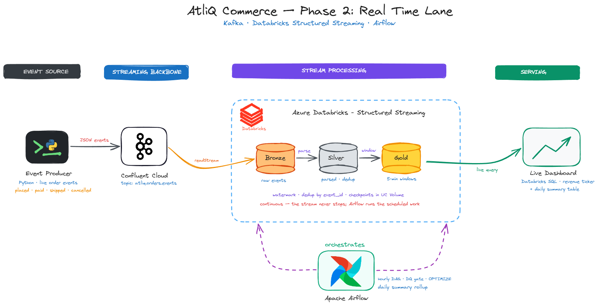
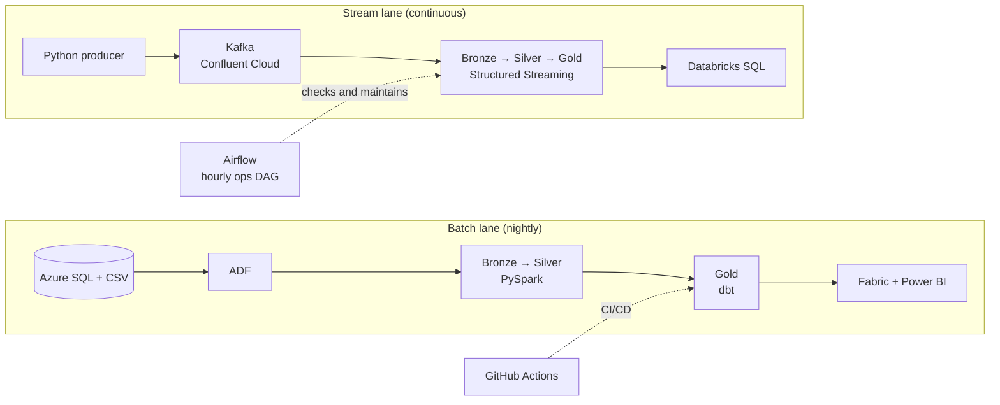

# AtliQ Commerce — End-to-End Data Engineering Capstone

A two-lane data platform for **AtliQ Commerce**, a fictional online retailer. The **batch lane** syncs the operational database and flat files to a star schema every night. The **stream lane** processes live order events in near real time. Both run on Azure and Databricks, and both are built on the medallion pattern (Bronze → Silver → Gold).

> **Created & developed by:** Ashish Rijal

---

## 🎯 Purpose of the Project

Leadership and operations need two different views of the same business:

- **Yesterday, in full and trustworthy detail:** revenue, margin and marketing performance, delivered to Power BI every morning.
- **Right now:** how many orders are coming in, and whether revenue just dropped in the last ten minutes.

This repository holds both solutions side by side, so one codebase shows how batch and streaming pipelines complement each other.

---

## 🧭 The Two Lanes

| | **Batch lane** ([`batch/`](batch/README.md)) | **Stream lane** ([`stream/`](stream/README.md)) |
|---|---|---|
| **Goal** | Nightly analytics: star schema and Power BI report | Live order events: 5-minute revenue ticker, daily summary |
| **Sources** | Azure SQL (OLTP, 5 tables) and CSV files | Python order event producer |
| **Transport / ingestion** | Azure Data Factory (metadata-driven) | Apache Kafka on Confluent Cloud |
| **Processing** | Databricks PySpark notebooks, then dbt Core for Gold | Databricks Structured Streaming |
| **Storage** | ADLS Gen2, Delta Lake, Unity Catalog | Delta Lake, Unity Catalog |
| **Gold output** | `fact_sales`, `dim_customer`, `dim_product`, `dim_date` | `gold_revenue_5min`, `gold_daily_summary` |
| **Orchestration** | ADF pipeline `PL_Nightly_Sync` | Airflow DAG `atliq_streaming_ops` |
| **Schedule** | Daily at 01:00 AM Eastern | Hourly (`@hourly`) |
| **Serving** | Microsoft Fabric and Power BI | Databricks SQL |
| **CI/CD** | GitHub Actions (dbt CI and prod) | Airflow DQ gate |

---

## 🏗️ Architecture

### Batch lane

<p align="center">
  
</p>

### Stream lane

<p align="center">
  
</p>

### How the lanes fit together



---

## 🧰 Technologies Used

| Category | Tools |
|---|---|
| Cloud | Microsoft Azure |
| Sources | Azure SQL Database, CSV files, Python event producer |
| Ingestion and transport | Azure Data Factory, Apache Kafka (Confluent Cloud) |
| Storage | Azure Data Lake Storage Gen2, Delta Lake, Unity Catalog |
| Processing | Azure Databricks, PySpark, Structured Streaming |
| Modeling and testing | dbt Core (dbt-databricks) |
| Orchestration | Azure Data Factory, Apache Airflow |
| Reporting and serving | Microsoft Fabric (OneLake), Power BI, Databricks SQL |
| CI/CD | Git, GitHub Actions |
| Languages | SQL, Python |

---

## 📁 Repository Structure

```
Eng_atliq_capstone_project_submission/
├── batch/                                    # Phase 1: nightly batch lane
│   ├── .github/workflows/                    # databricks_gold_ci.yml, databricks_gold_prod.yml
│   ├── 00_docs/                              # Architecture diagram (PNG, SVG)
│   ├── 01_source_ADLS_OLTP/                  # OLTP DDL, control tables, CSV files
│   ├── 02_ingestion_AzureDataFactory_ADF/    # ADF pipelines and nightly trigger
│   ├── 03_silver_Azure_Databricks/           # Bronze → Silver notebooks
│   ├── 04_gold_dbt/                          # dbt project: Gold models and tests
│   ├── 05_report_Microsoft_Fabric/           # Power BI report and snapshots
│   └── README.md
├── stream/                                   # Phase 2: real-time lane
│   ├── 00_docs/                              # Architecture diagram
│   ├── 01_producer/                          # Kafka order event producer
│   ├── 02_databricks/                        # Streaming notebook (Bronze → Silver → Gold)
│   ├── 03_airflow/dags/                      # Hourly ops DAG
│   ├── screenshots/                          # DAG runs and Gold table results
│   └── README.md
├── .gitignore
└── README.md                                 # This file
```

---

## 📝 Write-up

How the speed lane relates to the batch lane, when a business needs each, why Gold windows appear late, and why events are keyed by `order_id`: see [Speed lane vs. batch lane write-up](00_docs/speed_lane_writeup.md).

---

## 📚 Where to Go Next

- **[Batch lane README](batch/README.md):** components, schedule, Gold data model, setup steps.
- **[Stream lane README](stream/README.md):** event flow, DAG tasks, results and setup steps.

---

## 🔐 Security Note

Never commit real credentials. `.env`, `*.env` and `.env.local` are ignored through `.gitignore`. Only `.env.example` is kept in Git, and Kafka keys in notebooks should come from a Databricks secret scope.
