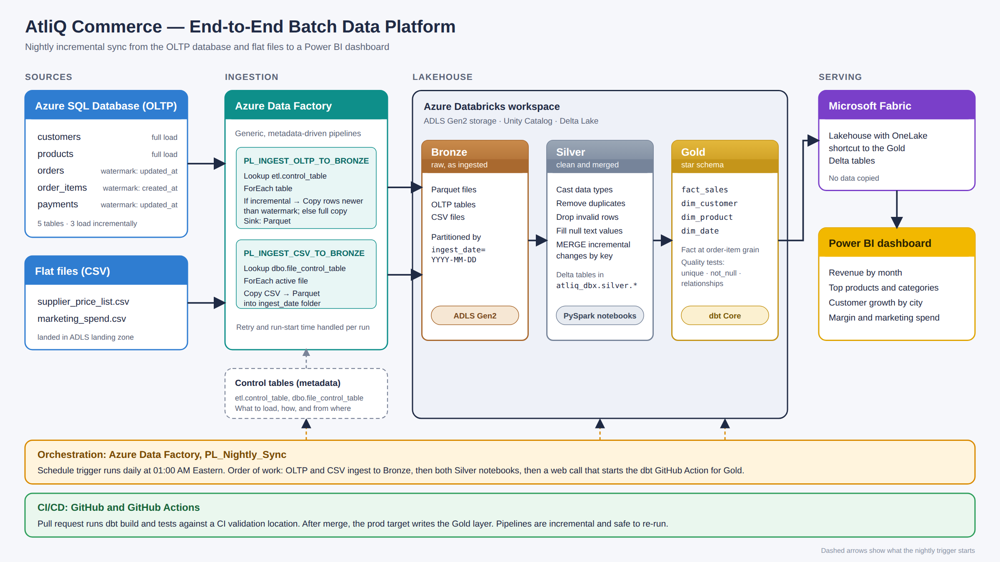
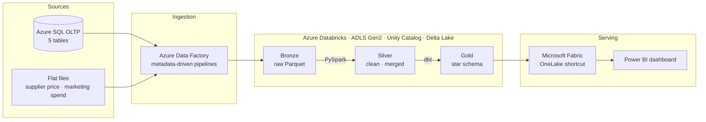

# AtliQ Commerce — End-to-End Data Engineering Capstone

An end-to-end batch data platform for **AtliQ Commerce**, a fictional online retailer. It takes raw orders, customers, products and payments from an operational database, plus supplier and marketing flat files, and turns them into a clean star schema that powers a Power BI dashboard — refreshed automatically every night.

> **Created & developed by:** Ashish Rijal

---

## 🎯 Purpose of the Project

AtliQ's order data lives in an operational (OLTP) database that isn't suited for reporting, and supplier prices and marketing spend sit in separate CSV files. Leadership has no single, trustworthy view of revenue, margin, or marketing performance.

This project builds a **nightly, incremental, idempotent pipeline** that:

- Ingests OLTP tables and CSV files into a data lake with a generic, metadata-driven framework
- Cleans and standardises the data in a Silver layer
- Models it into a Gold star schema with automated data-quality tests
- Serves it to Power BI through Microsoft Fabric for business reporting

---

## 🏗️ Architecture

### Version 1: Original diagram


### Version 2: Detailed diagram (PNG)

<p align="center">
  
</p>


### Version 3: Detailed diagram (SVG, zoomable)



---

### Components

| Layer | Component | Role |
|---|---|---|
| **Sources** | Azure SQL Database (OLTP) | `customers`, `products`, `orders`, `order_items`, `payments` |
| | Flat files (CSV) | `supplier_price_list`, `marketing_spend` landed in ADLS |
| **Ingestion** | Azure Data Factory | `PL_INGEST_OLTP_TO_BRONZE` (reads `etl.control_table`: full vs. incremental load using watermark columns) and `PL_INGEST_CSV_TO_BRONZE` (reads `dbo.file_control_table`) → Parquet in Bronze, partitioned by `ingest_date` |
| | Control tables | Metadata that drives which tables/files load, how, and from what watermark |
| **Storage** | Azure Data Lake Storage Gen2 | `bronze / silver / gold` containers (Delta + Parquet) |
| **Transform** | Azure Databricks (PySpark) | `NB_Bronze_To_Silver` and `NB_Bronze_To_Silver_CSV` — type casting, de-duplication, validation, MERGE of incremental changes into Delta tables in Unity Catalog |
| | dbt Core | Gold models: `dim_customer`, `dim_product`, `dim_date`, `fact_sales` (order-item grain) with `unique`, `not_null` and `relationships` tests |
| **Orchestration** | `PL_Nightly_Sync` (ADF) | Runs OLTP ingest and CSV ingest → both Silver notebooks → triggers the dbt GitHub Action |
| **CI/CD** | GitHub Actions | Runs dbt build/tests on pull requests (against a CI schema) and deploys to the prod Gold layer |
| **Serving** | Microsoft Fabric + Power BI | OneLake shortcut to Gold Delta tables; dashboard for revenue, margin and marketing KPIs |

---

## ⏰ Schedule

| Item | Detail |
|---|---|
| Trigger | `trigger_Nightly_Sync` (ADF Schedule Trigger) |
| Frequency | **Daily, every 1 day at 01:00 AM Eastern Time** |
| Pipeline | `PL_Nightly_Sync` |
| Load pattern | Incremental via watermark (`updated_at` / `created_at`) — safe to re-run (idempotent) |
| Flow | OLTP + CSV → Bronze → Silver (PySpark) → Gold (dbt via GitHub Actions) → Power BI |

---

## 🧰 Technologies Used

| Category | Tools |
|---|---|
| Cloud | Microsoft Azure |
| Source database | Azure SQL Database |
| Storage | Azure Data Lake Storage Gen2 |
| Ingestion / orchestration | Azure Data Factory |
| Processing | Azure Databricks, PySpark, Delta Lake, Unity Catalog |
| Modeling & testing | dbt Core (dbt-databricks) |
| Reporting | Microsoft Fabric (OneLake), Power BI |
| CI/CD | Git, GitHub Actions |
| Languages | SQL, Python |

---

## 🧱 Data Model (Gold)

```
dim_customer ─┐
dim_product  ─┼──► fact_sales (one row per order item)
dim_date     ─┘
```

`fact_sales` includes `gross_revenue = quantity × item_price`. `dim_product` joins supplier cost to compute `unit_margin`.

---

## 📁 Repository Structure

```
Eng_atliq_capstone/
├── .github/                              # GitHub Actions CI/CD workflow (dbt build and tests)
├── 00_docs/                              # Architecture diagram, implementation guide
├── 01_source_ADLS_OLTP/                  # Source layer: OLTP schema DDL, ETL control tables, CSV files
├── 02_ingestion_AzureDataFactory_ADF/    # ADF pipelines and nightly schedule trigger (JSON)
├── 03_silver_Azure_Databricks/           # Databricks notebooks (Bronze → Silver, PySpark)
├── 04_gold_dbt/                          # dbt project: Gold models, sources, tests
├── 05_report_Microsoft_Fabric/           # Fabric / Power BI reporting assets
├── .gitignore
└── README.md
```

The numbered folders follow the order of the data flow, from source to report.

---

## 🚀 Getting Started

1. Provision Azure SQL, ADLS Gen2, Data Factory, and a Databricks workspace with Unity Catalog.
2. Run the DDL scripts and seed the control tables.
3. Import the ADF pipelines and trigger; configure linked services.
4. Deploy the Databricks notebooks and configure the dbt `profiles.yml` (via GitHub secrets for CI).
5. Connect Microsoft Fabric to the Gold container with a OneLake shortcut and build the Power BI report.
